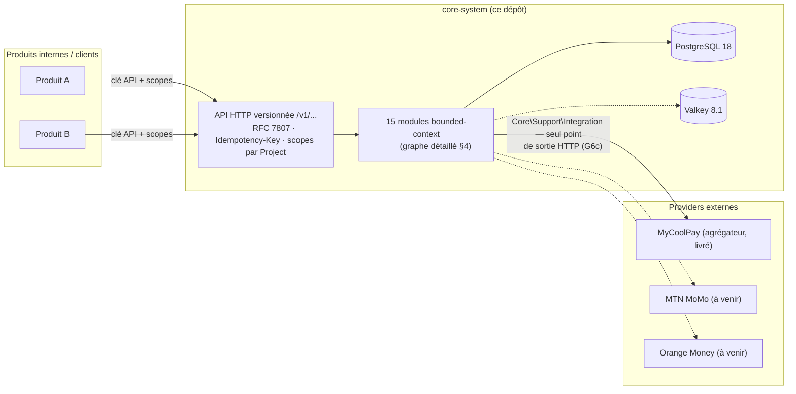
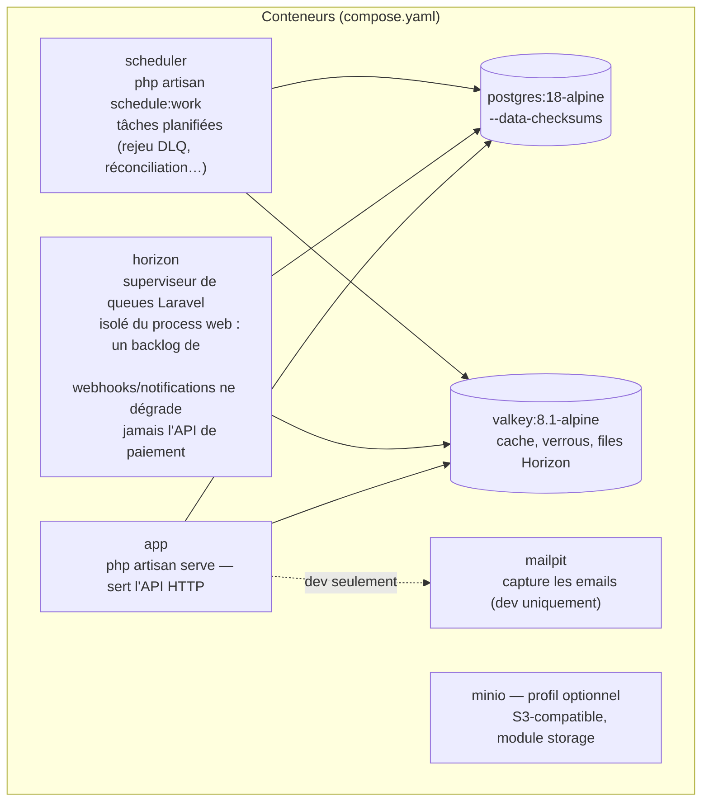
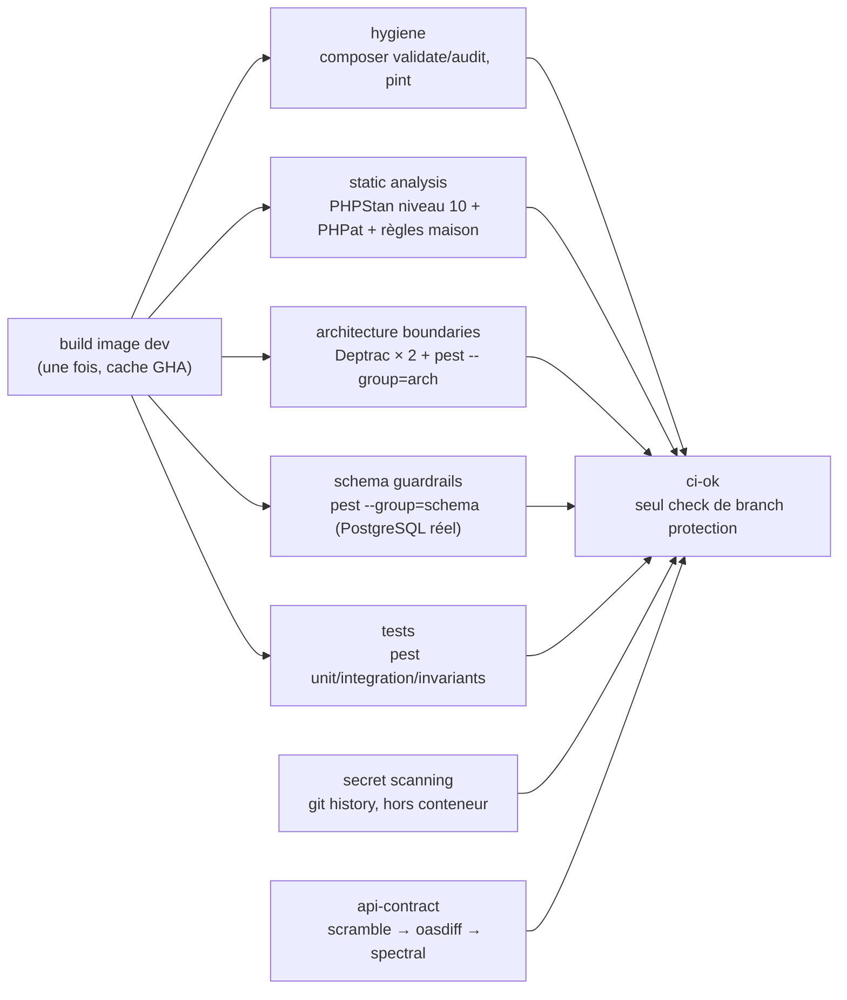
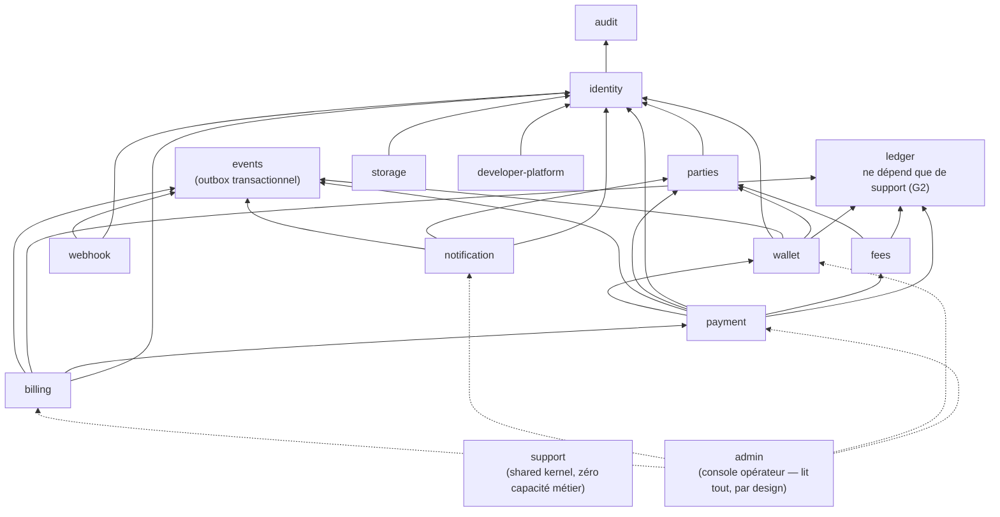
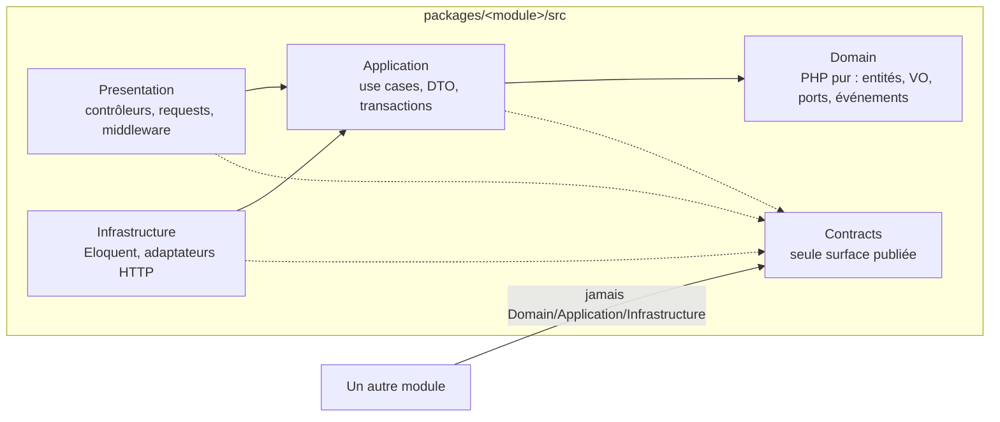
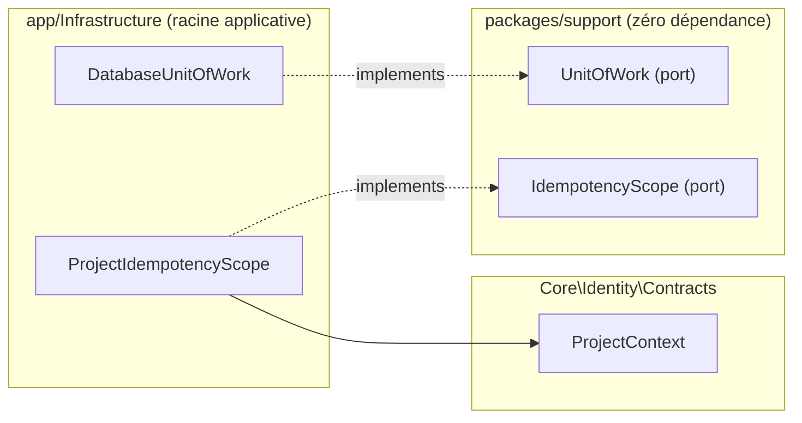
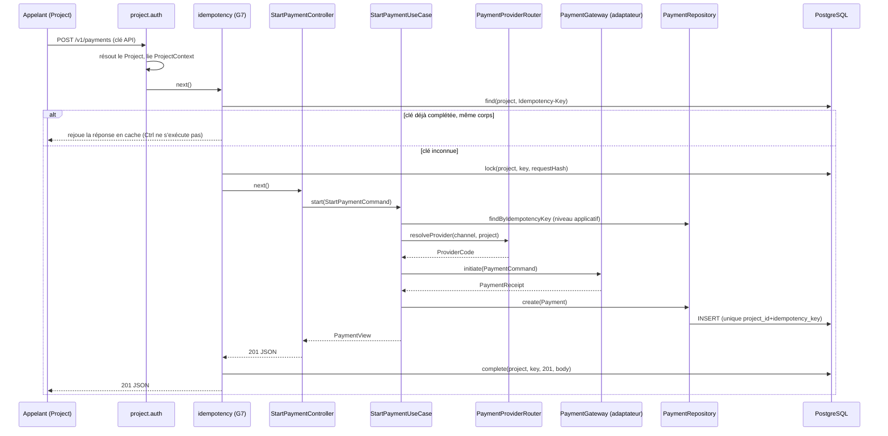
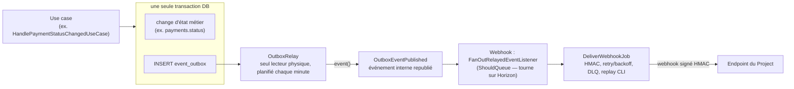
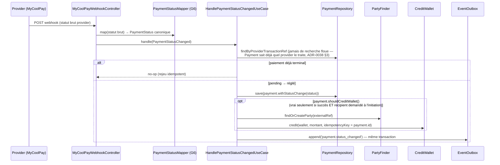
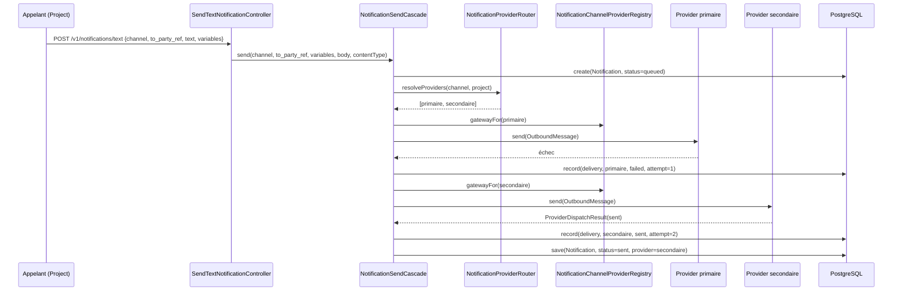

# Vue d'ensemble de l'architecture

Ce document donne, en une seule lecture, la vue globale du système : ce qu'il
est, comment les modules se découpent et se parlent, comment une requête
traverse les couches, et comment le paiement (le cas le plus abouti à ce
jour) illustre tout le reste. Il ne remplace pas les ADR — il en est la
synthèse visuelle. Pour le « pourquoi » de chaque choix, suivre les liens vers
`docs/adr/`.

**À lire en complément :**
[docs/adr/README.md](../adr/README.md) (le « pourquoi ») ·
[garde-fous-inactifs.md](garde-fous-inactifs.md) (ce qui est vérifié par CI) ·
[docs/specs/plan-delivery-mvp.md](../specs/plan-delivery-mvp.md) (le séquencement en 8 lots).

---

## 1. Ce que c'est

**core-system** est un monolithe modulaire Laravel qui joue le rôle de socle
transverse pour plusieurs produits : identité/tenancy, ledger comptable
double-entrée immuable, wallets, orchestration de paiement (adaptateurs
mobile money), frais, notifications, webhooks sortants, audit. Un produit ne
touche jamais directement les tables de ce dépôt : il consomme une API HTTP
versionnée, ou réagit aux événements publiés via l'outbox.

Chaque `Project` (rattaché à une `Organization`) s'authentifie par clé API et
ne voit que ses propres données — le scoping projet traverse tout le système
(ADR-0014). Une requête qui mute de l'argent doit porter un `Idempotency-Key`
(G7). Toute erreur répond au format `application/problem+json` (RFC 7807).

---

## 2. Topologie d'exécution (infrastructure)

Le `Dockerfile` est multi-stage (`dev` / `vendor` / `production`,
ADR-0019 Docker-first) : le même artefact tourne en local et en CI — « ça
marche chez moi » et « ça marche en CI » désignent la même image. Le runtime
local (`compose.yaml`) sépare les responsabilités en process distincts :

Pourquoi trois process Laravel séparés plutôt qu'un seul : un pic de charge
côté webhooks entrants, ou un traitement lent en file, ne doit jamais faire
attendre `POST /v1/payments`. **Valkey plutôt que Redis** : Redis 8.x est
passé AGPL/SSPL, une vraie question de licence pour une plateforme
financière propriétaire (ADR-0017) — protocole compatible, Horizon et
`phpredis` ne changent pas d'une ligne. Extensions PHP clés de l'image :
`bcmath`/`gmp` (arithmétique entière exacte pour le ledger, jamais de
flottant), `pdo_pgsql`, `redis`, `pcntl` (signaux des workers Horizon).

## 3. Environnements, configuration et déploiement

Deux axes de configuration, volontairement séparés :

- **`APP_ENV`** (`local`/`testing`/`production`) — le mode Laravel classique
  (debug, cache de config…).
- **`CORE_ENVIRONMENT`** (`sandbox`/`staging`/`live`) — l'environnement
  **métier** : sandbox et live ont des identifiants, données et effets
  totalement isolés (aucun mouvement d'argent réel en sandbox), même si les
  deux tournent avec `APP_ENV=production`. C'est cet axe qui détermine par
  exemple quelles clés provider un `Project` peut utiliser.

Le pipeline CI (`.github/workflows/ci.yml`) construit une seule fois
l'image `dev` (Buildx, cache GHA) et la réutilise pour chaque gate, en
parallèle — c'est le même artefact que celui utilisé en local :

En nightly (`.github/workflows/nightly.yml`, hors du chemin critique de
développement) : cohérence du graphe de modules, tests de mutation
(Infection, cantonnés au `Domain`/`Application` des modules financiers), et
détection de dépendances Composer non déclarées.

---

## 4. Les modules et leur graphe de dépendances

Le graphe ci-dessous est dérivé de la **source unique de vérité**,
[`tests/Architecture/ModuleGraph.php`](../../tests/Architecture/ModuleGraph.php) —
Deptrac (`deptrac-modules.yaml`), les `composer.json` de chaque module et ce
fichier doivent tous les trois s'accorder (G1, G1b), sous peine d'échec CI.
Le modifier est une décision d'architecture (ADR + comité), pas un refactor.

> Tous les modules dépendent aussi de `support` (omis ci-dessus pour la
> lisibilité — sinon 15 flèches convergeraient vers la même boîte). `ledger`
> est la seule ligne vide de tout le graphe : **rien ne peut jamais pousser
> une dépendance sur le ledger** — c'est la garantie la plus importante du
> dépôt.

### État de chaque module (2026-09-15)

| Module | Rôle | État | Lot | Points d'entrée notables |
| ------ | ---- | ---- | --- | ------------------------- |
| `support` | Shared kernel technique (Money, Clock, Identifier, UnitOfWork, ProblemDetails, Idempotency, Integration HTTP) | **Livré** | Lot 0 | — (pas de HTTP propre) |
| `identity` | Organization/Project/ApiKey, auth, scopes ; Operator/RBAC/MFA (Lot 6) | **Livré** | Lot 1 (+ Lot 6) | `GET /v1/whoami`, `POST /v1/operators/{login,mfa/enroll,mfa/confirm,mfa/verify,logout}`, `GET /v1/operators/me` |
| `audit` | Journal d'audit (écriture Lot 1, lecture Lot 6) | **Livré** | Lot 1 (+ Lot 6) | — (lu par `admin` via `AuditQuery`) |
| `events` | Outbox transactionnel (table unique, ADR-0024) + relais unique (ADR-0040) | **Livré** | Lot 2 écriture (ADR-0032), Lot 4 relais | — (commande `events:relay`, planifiée) |
| `parties` | Tiers à création paresseuse, aucune PII (G4) | **Livré** | Lot 2 | — |
| `ledger` | Comptabilité double-entrée immuable, contraintes PostgreSQL réelles | **Livré** | Lot 2 | — |
| `wallet` | Crédit/débit, solde matérialisé + dérivé | **Livré** | Lot 2 | `GET /v1/wallets/{id}/balance` (lecture seule, ADR-0033 §1) |
| `payment` | Channel canonique, routage par Project, orchestration, webhook, idempotence HTTP | **Livré** (Lot 3, ADR-0038/0039) | Lot 3 | `POST /v1/payments`, `GET /v1/payments/{id}`, webhook MyCoolPay |
| `fees` | Moteur de frais | Scaffold — **hors périmètre production** (ADR-0048) | Lot 3 (en pause) | — |
| `webhook` | Endpoints par Project, livraison signée HMAC, retry/backoff, DLQ, replay CLI (ADR-0009, ADR-0040) | **Livré** | Lot 4 | `POST/GET /v1/webhook-endpoints`, `DELETE /v1/webhook-endpoints/{id}` |
| `notification` | Orchestration multi-canal : fallback ordonné, `NotificationStatus` canonique (ADR-0041), contenu envoyé en ligne — pas de template pré-enregistré (ADR-0043). Adaptateur WhatsApp/WAHA livré (ADR-0042). | **Livré** | Lot 5 | `POST /v1/notifications/{text,image,file}`, `GET /v1/notifications/{id}`, `GET/POST /v1/notification-channel-sessions/{channel}/{sessionRef}/*`, webhook `whatsapp-waha` |
| `admin` | Console opérateur | **Livré (3 tranches)** | Lot 6 | `GET /v1/admin/audit-log`, `GET /v1/admin/webhook-deliveries/dead`, `POST .../{id}/replay`, `POST /v1/admin/payment-reconciliation-runs`, `GET /v1/admin/projects[/{id}/{payments,wallets,notifications}]`, `GET/POST /v1/admin/operators`, `POST /v1/admin/operators/{id}/revoke` |
| `billing` | Facturation | Scaffold — **hors périmètre production** (ADR-0048) | — | — |
| `storage` | Fichiers | Scaffold — **hors périmètre production** (ADR-0048) | — | — |
| `developer-platform` | Auto-service développeur | Scaffold — **hors périmètre production** (ADR-0048) | — | — |

---

## 5. L'intérieur d'un module : architecture hexagonale

Chaque module suit la même structure interne, et la direction des
dépendances est vérifiée par deux outils complémentaires (Deptrac pour « quel
répertoire peut référencer quel répertoire », PHPat pour « quelle classe peut
référencer quel type », type-aware — voir G3/G3b/G3c/G3d).

**La règle la plus facile à oublier — et la plus vérifiée cette session** :
`Domain` ne dépend de **rien**, pas même du `Contracts/` de son propre
module. Un objet du Domain qui a besoin d'une donnée qui transite par
`Contracts` (ex. un DTO externe) doit la recevoir déjà traduite en types
Domain — la traduction se fait dans `Application`, jamais dans `Domain`. C'est
exactement le problème rencontré en construisant `Payment` : son premier
brouillon important `Core\Payment\Contracts\PaymentReceipt` depuis le Domain,
rejeté par Deptrac/PHPStan ; la traduction a été déplacée dans
`StartPaymentUseCase`.

| Répertoire | Contient | Peut dépendre de |
| ---------- | -------- | ------------------ |
| `Domain/` | Entités, value objects, ports, événements de domaine | rien (`Domain: ~`) |
| `Contracts/` | Interfaces, DTO, VO publiés | rien (`Contracts: ~`) |
| `Application/` | Use cases, orchestration transactionnelle | `Domain` + `Contracts` (propre et externes) |
| `Infrastructure/` | Implémentations des ports (Eloquent, HTTP) | `Application` + `Domain` + `Contracts` |
| `Presentation/` | Contrôleurs, form requests, middleware | `Application` + `Domain` + `Contracts` |

---

## 6. Le shared kernel `core/support`

`support` est le seul module dont **tous** les autres peuvent dépendre, et il
ne persiste jamais rien lui-même (G3d — pas d'Eloquent, `DB`, `Schema`,
`Redis` dans `support`). Quand une primitive de `support` a besoin d'une
donnée que seul un autre module peut fournir (ex. « quel est le Project
courant » pour scoper l'idempotence), la solution n'est **pas** de faire
dépendre `support` de ce module, mais de définir un **port** dans `support`
et de l'implémenter dans `app/Infrastructure/` (la racine applicative, seul
endroit qui a le droit de connaître tous les modules à la fois) :

Ce que contient `support` aujourd'hui : `Money` (enveloppe autour de
`brick/money`, jamais traversée telle quelle entre modules — ADR-0021),
`Clock`/`Identifier` (Uuid v7), `UnitOfWork` (port), `ProblemDetails` (RFC
7807), `CorrelationId`, **`Idempotency`** (store/port HTTP, ADR-0025, livré
cette session), et **`Integration`** (le seul point de sortie HTTP du dépôt —
G6c : pipeline timeout/retry/circuit-breaker/auth/signature
HMAC/corrélation/redaction, ADR-0026/0031/0034).

---

## 7. Anatomie d'une requête qui mute de l'argent

`POST /v1/payments` comme exemple concret : deux niveaux d'idempotence
coexistent (HTTP, G7, ADR-0025 — protège contre le double-clic/retry réseau ;
applicatif, sur `(project_id, idempotency_key)` — protège contre une vraie
requête concurrente qui a passé le premier niveau).

Le `channel` (`mtn_momo`, `orange_money`, `card`…) est **canonique et
public** ; le `provider` (`my-coolpay`, futur `mtn-direct`…) est **interne,
jamais exposé**. `PaymentProviderRouter` résout `(channel, Project) →
provider` — c'est le mécanisme qui permet d'ajouter un adaptateur MTN/Orange
direct demain sans toucher au contrat public (ADR-0038 §1–2).

---

## 8. Le pattern outbox : aucun événement sans transaction

`G8` interdit `event()`/`dispatch()` dans `Domain/`ou `Application/` : un
changement d'état métier et la ligne qu'il publie dans `event_outbox`
partagent **toujours** la même transaction (G8c). Le relais qui lit cette
table et livre les événements vers des webhooks sortants signés (ADR-0009)
est **livré** (Lot 4, ADR-0040) : `Core\Events\Infrastructure\Relay\OutboxRelay`
est le seul lecteur physique de la table — planifié chaque minute
(`events:relay`) — et republie chaque ligne comme
`OutboxEventPublished`, un événement Laravel interne auquel un ou
plusieurs modules s'abonnent (`webhook` aujourd'hui) sans jamais relire
l'outbox eux-mêmes : `published_at` ne peut signifier qu'« un seul lecteur
en amont », jamais « lu par chaque consommateur ».

---

## 9. Cas bout-en-bout : paiement confirmé, wallet crédité *sur demande seulement*

C'est la décision la plus corrigée de tout le projet, donc la plus utile à
visualiser : un paiement réussi **n'implique jamais** un wallet crédité, sauf
si l'appelant l'a explicitement demandé à l'initiation
([ADR-0037](../adr/0037-credit-wallet-jamais-automatique-composition-explicite.md)).
Le mécanisme de crédit, lui, est tranché : synchrone, même transaction que la
mise à jour du statut
([ADR-0036](../adr/0036-paiement-confirme-credite-le-wallet-en-synchrone.md)).

`shouldCreditWallet()` vit dans le Domain (`Payment`) et encode la règle en
code, pas seulement en documentation — la même méthode est testée en
isolation (fakes) et en intégration réelle contre PostgreSQL
(`PaymentToWalletIntegrationTest`), y compris le cas « paiement réussi, mais
sans instruction de crédit : wallet et ledger restent intouchés ».

---

## 10. Notification : fallback synchrone, pas retry différé

Autre lecture de la même famille de problème (routage multi-provider),
avec une décision différente et volontairement documentée (ADR-0041) :
`webhook` retarde une tentative sur la **même** cible après échec
(`next_retry_at`, Horizon `release()`, §8) ; `notification` bascule
**immédiatement** vers le provider suivant d'une chaîne ordonnée — un
fallback synchrone, pas un retry différé. Chaque tentative (réussie ou
non) est tracée dans `notification_deliveries`. Trois endpoints publics,
un par type de contenu (`POST /v1/notifications/text|image|file`, ADR-0043
— pas de template pré-enregistré) délèguent tous à la même cascade
partagée, `NotificationSendCascade`.

Adaptateur concret livré : WhatsApp via WAHA auto-hébergé (ADR-0042) —
`WahaAdapter` implémente `NotificationChannelProvider` (même
`ProviderGateway` générique que `PaymentGateway`, même registre) **et**
un second port, `ChannelSessionProvider`, pour la liaison de téléphone
(QR/pairing-code/screenshot, `/v1/notification-channel-sessions/{channel}/{sessionRef}/*`)
— le Core ne persiste rien sur une session, `sessionRef` est fourni par
l'appelant à chaque requête. `HandleNotificationStatusChangedUseCase`
(statuts entrants → `notification.delivered`/`.read`/`.failed`) est
appelé par `WahaWebhookController` (`POST /webhooks/whatsapp-waha`).
`FakeNotificationChannelProvider` reste utilisé pour les tests.

**Rien dans le Core ne déclenche une notification automatiquement** —
les endpoints `send-*` sont la seule porte d'entrée, même en réaction à
un `payment.status_changed` : c'est une décision explicite d'ADR-0041,
qui évite de reproduire l'erreur corrigée par ADR-0037 (crédit de wallet
automatique).

---

## 11. Garde-fous — la liste courte

Le détail complet, avec l'outil et le fichier qui enforce chacun, vit dans
[garde-fous-inactifs.md](garde-fous-inactifs.md) (et
`tests/Architecture/GuardRegistry.php` pour la déclaration exécutable). En un
coup d'œil :

| Catégorie | Garde-fous | Vérifié par |
| --------- | ---------- | ----------- |
| Graphe de modules | G1, G1b, G2 | Deptrac + Pest |
| Couches internes | G3, G3b, G3c, G3d | Deptrac + PHPat |
| Schéma financier | G4 (pas de PII sur `parties`), G5 (montants en `bigint`) | Pest + introspection PostgreSQL |
| Statuts provider | G6, G6c | Règle PHPStan maison + PHPat |
| Vocabulaire canonique | G6b (`PaymentStatus`, `NotificationStatus`) | Pest |
| Mutation monétaire | G7 (`Idempotency-Key` obligatoire) | Pest, application bootée |
| Événements | G8, G8c (outbox transactionnel) | PHPat + règle PHPStan + Pest |
| Contrat API | G9 (pas de rupture OpenAPI sans version), G10 (contrat consommateur, Lot 7) | oasdiff + Spectral |
| Ledger | G11 (somme nulle, solde dérivé, concurrence, rejeu) | Pest + PostgreSQL |

`make guard-test` injecte une vraie violation de chaque garde-fou actif et
vérifie le rejet — c'est la seule façon de savoir qu'un garde-fou protège
réellement quelque chose.

---

## 12. Conventions transverses

- **Argent** : toujours `bigint` minor units + `currency char(3)`, jamais
  `float`/`decimal` (G5). Enveloppe `Money` (ADR-0021) — `Brick\Money` ne
  traverse jamais une frontière de module.
- **Identifiants** : UUID v7 partout (`Core\Support\Identifier`).
- **Temps** : `timestamptz` en base, `Clock` injecté (jamais `now()` en dur
  dans `Domain`/`Application`).
- **Erreurs HTTP** : `application/problem+json` (RFC 7807) via
  `Core\Support\Http\ProblemDetails`.
- **Versionnement API** : préfixe d'URL (`/v1/...`, ADR-0028), pas
  d'en-tête ni de négociation de contenu.
- **Idempotence** : deux niveaux — HTTP (`Idempotency-Key`, G7) et
  applicatif (`(project_id, idempotency_key)` unique en base), voir §7.
- **Multi-tenance** : base partagée, scoping par `project_id` sur chaque
  table, jamais de jointure inter-module en base — uniquement des
  identifiants de corrélation (`external_ref`, `correlation_id`).

---

## 13. Pour aller plus loin

- **Pourquoi chaque décision** : [docs/adr/README.md](../adr/README.md) —
  41 ADR à ce jour, y compris les deux refus/corrections tracés en ADR
  (0036 → corrigé par 0037).
- **Ce qui est réellement vérifié par la CI** :
  [garde-fous-inactifs.md](garde-fous-inactifs.md).
- **Le plan de livraison en 8 lots** :
  [docs/specs/plan-delivery-mvp.md](../specs/plan-delivery-mvp.md).
- **Le détail par module** : `packages/<module>/README.md`.
- **Ce qui n'existe pas encore** : section dédiée dans
  [CLAUDE.md](../../CLAUDE.md) à la racine — à ne jamais supposer construit
  sans vérifier.
